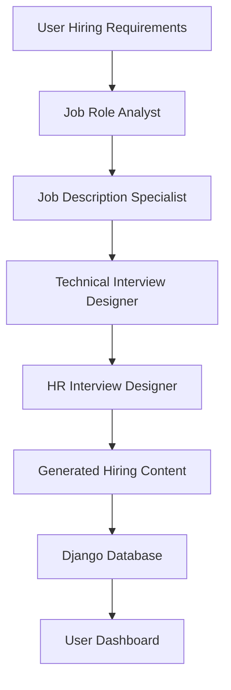
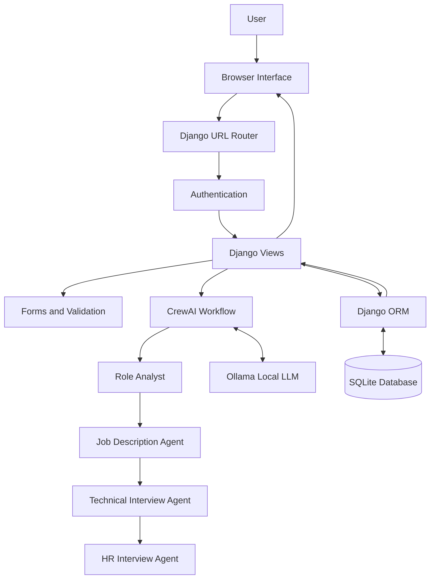
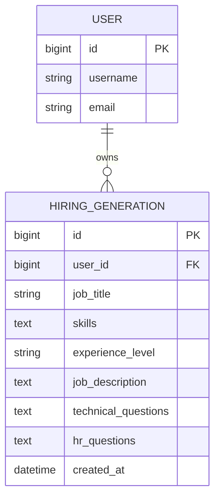

# 🚀 HirePilot AI – AI-Powered Hiring Assistant


**HirePilot AI** is an AI-powered hiring assistant developed using Python, Django, CrewAI, and Ollama. It helps recruiters and hiring managers generate structured job descriptions, technical interview questions, and HR interview questions through an automated multi-agent AI workflow.

The application uses a locally running Large Language Model (LLM) through Ollama, reducing dependency on external AI APIs.

> AI-generated content is intended to support recruiters and hiring managers. All generated content should be reviewed by humans before being used in recruitment decisions.

---

## 📌 Table of Contents

- [Overview](#-overview)
- [Problem Statement](#-problem-statement)
- [Objectives](#-objectives)
- [Key Features](#-key-features)
- [AI Agent Architecture](#-ai-agent-architecture)
- [Application Workflow](#-application-workflow)
- [Technology Stack](#-technology-stack)
- [Project Structure](#-project-structure)
- [Installation and Setup](#-installation-and-setup)
- [Environment Configuration](#-environment-configuration)
- [Running the Application](#-running-the-application)
- [Application Routes](#-application-routes)
- [Database Design](#-database-design)
- [Security](#-security)
- [Current Limitations](#-current-limitations)
- [Future Enhancements](#-future-enhancements)
- [Contributing](#-contributing)
- [License](#-license)

---

## 📖 Overview

Recruiters often spend considerable time preparing job descriptions and interview questions for different job roles.

HirePilot AI aims to simplify this process through an intelligent multi-agent system.

The application accepts hiring requirements such as:

- Job title
- Required technical skills
- Experience level
- Additional role details

Based on these inputs, four specialized AI agents collaborate to generate:

1. Job role analysis.
2. Structured job description.
3. Technical interview questions with expected-answer guidance.
4. HR and behavioral interview questions with evaluation guidance.

Users can access their generated results through an authenticated dashboard.

## 🎯 Problem Statement

Traditional hiring preparation involves manually creating job descriptions and interview questions for every position.

This process can be time-consuming and may result in inconsistent interview preparation.

HirePilot AI addresses this challenge by introducing a multi-agent AI workflow that helps organize and automate hiring preparation activities.

## 🎯 Objectives

- Automate job description generation.
- Generate role-specific technical interview questions.
- Prepare HR and behavioral interview questions.
- Implement AI agents using CrewAI.
- Integrate a locally running LLM using Ollama.
- Develop a secure backend using Django.
- Store and manage generated hiring records using SQLite.

---

## ✨ Key Features

### 1. User Authentication
- User registration.
- Secure login and logout.
- Session-based authentication.
- Protected application pages.

### 2. AI-Powered Job Description Generation
- Accepts job role and required skills.
- Analyzes role requirements.
- Generates structured job descriptions.

### 3. Technical Interview Question Generation
- Generates 10 technical interview questions.
- Provides expected-answer guidance.
- Uses job role and skill requirements as context.

### 4. HR Interview Question Generation
- Generates 8 HR and behavioral questions.
- Provides evaluation guidance.
- Focuses on job-related behavioral assessment.

### 5. Multi-Agent AI Workflow
- Four specialized CrewAI agents.
- Sequential task execution.
- Local LLM integration through Ollama.

### 6. Hiring Dashboard
- Displays saved generation history.
- Allows users to access their previous results.
- Restricts records to their respective owners.

### 7. Database Management
- Uses Django ORM.
- Stores hiring requirements and generated results.
- Maintains user-specific generation history.

---

## 🤖 AI Agent Architecture

One of the main components of HirePilot AI is its four-agent architecture.

Each agent is assigned a specific responsibility.

| AI Agent | Responsibility |
|---|---|
| Job Role Analyst | Analyzes job roles, experience levels, and required skills. |
| Job Description Specialist | Creates structured job descriptions. |
| Technical Interview Designer | Generates 10 technical questions with answer guidance. |
| HR Interview Designer | Generates 8 behavioral questions with evaluation guidance. |

### Agent Execution Workflow



CrewAI manages the sequential execution of these specialized agents, while Ollama provides local language model inference.

---

## 🏗️ System Architecture

HirePilot AI follows the Django Model-View-Template (MVT) architecture.



### Architecture Components

- **Frontend:** Django Templates, HTML, and CSS.
- **Backend:** Django views, forms, URL routing, and business logic.
- **AI Layer:** CrewAI agents and sequential tasks.
- **LLM Layer:** Ollama with Llama 3.2.
- **Database:** SQLite with Django ORM.

The application is implemented as a server-rendered Django application rather than a separate React or Node.js frontend.

---

## 🔄 Application Workflow

1. The user opens the HirePilot AI application.
2. The user registers or logs in.
3. The application displays the hiring dashboard.
4. The user enters the job title, skills, experience level, and additional details.
5. Django validates the submitted information.
6. CrewAI initializes the four specialized AI agents.
7. The Job Role Analyst analyzes the requirements.
8. The Job Description Specialist generates the job description.
9. The Technical Interview Designer generates technical questions.
10. The HR Interview Designer generates behavioral questions.
11. Django stores the generated results in SQLite.
12. The user views the generated content through the result page.

---

## 🛠️ Technology Stack

| Technology | Purpose |
|---|---|
| Python 3.10–3.13 | Core programming language |
| Django 5.2.8 | Backend web framework |
| CrewAI 1.5.0 | Multi-agent orchestration |
| Ollama | Local LLM execution |
| Llama 3.2 | Language model |
| LiteLLM | LLM provider integration |
| SQLite | Database |
| Django ORM | Database operations |
| HTML5 | Application structure |
| CSS3 | User interface styling |
| python-dotenv | Environment configuration |

---

## 📂 Project Structure

```text
crewai-django-hiring-assistant/
│
├── manage.py
├── requirements.txt
│
├── crewai_django_hiring_assistant/
│   │
│   ├── .env.example
│   │
│   ├── ai_agents/
│   │   ├── agents.py
│   │   ├── crew.py
│   │   └── tasks.py
│   │
│   ├── assistant/
│   │   ├── migrations/
│   │   ├── admin.py
│   │   ├── forms.py
│   │   ├── models.py
│   │   ├── urls.py
│   │   └── views.py
│   │
│   ├── config/
│   │   ├── settings.py
│   │   ├── urls.py
│   │   ├── wsgi.py
│   │   └── asgi.py
│   │
│   ├── static/
│   │   └── css/
│   │       └── style.css
│   │
│   └── templates/
│       └── assistant/
│
└── README.md
```

---

## ⚙️ Installation and Setup

### Prerequisites

Install the following before running the application:

- Python 3.10–3.13
- Django
- Ollama
- Git
- Minimum 8 GB RAM recommended; 16 GB or more is preferable.

### Step 1: Clone the Repository

```bash
git clone https://github.com/Siva1286/crewai-django-hiring-assistant.git
```

```bash
cd crewai-django-hiring-assistant
```

### Step 2: Create a Virtual Environment

**Windows PowerShell:**

```powershell
py -3.11 -m venv .venv
```

```powershell
.\.venv\Scripts\Activate.ps1
```

### Step 3: Install Dependencies

```bash
python -m pip install --upgrade pip
```

```bash
pip install -r requirements.txt
```

### Step 4: Install and Configure Ollama

Install Ollama from:

https://ollama.com/

Start the Ollama service:

```bash
ollama serve
```

Open another terminal and download the model:

```bash
ollama pull llama3.2
```

Run the model:

```bash
ollama run llama3.2
```

After testing the model, exit using:

```text
/bye
```

---

## 🔐 Environment Configuration

Create a `.env` file inside the `crewai_django_hiring_assistant` directory.

Copy the example configuration:

```powershell
Copy-Item .\crewai_django_hiring_assistant\.env.example .\crewai_django_hiring_assistant\.env
```

Add the following configuration:

```env
SECRET_KEY=your-generated-secret-key
DEBUG=True
ALLOWED_HOSTS=127.0.0.1,localhost

OLLAMA_MODEL=ollama/llama3.2
OLLAMA_BASE_URL=http://localhost:11434
```

Generate a Django secret key:

```bash
python -c "from django.core.management.utils import get_random_secret_key; print(get_random_secret_key())"
```

**Important:** Never upload your actual `.env` file or Django secret key to GitHub.

---

## ▶️ Running the Application

After installing the dependencies and configuring Ollama, execute the following commands.

### Step 1: Apply Database Migrations

```bash
python manage.py migrate
```

### Step 2: Create an Admin Account

```bash
python manage.py createsuperuser
```

### Step 3: Check the Django Application

```bash
python manage.py check
```

### Step 4: Start the Development Server

```bash
python manage.py runserver
```

### Step 5: Open the Application

Application:

```text
http://127.0.0.1:8000/
```

Django Administration:

```text
http://127.0.0.1:8000/admin/
```

**Note:** AI generation may take several minutes depending on your system hardware and local model performance.

---

## 🌐 Application Routes

| HTTP Method | Route | Purpose |
|---|---|---|
| GET | `/` | Landing page |
| GET / POST | `/register/` | User registration |
| GET / POST | `/login/` | User login |
| POST | `/logout/` | User logout |
| GET | `/dashboard/` | Hiring dashboard |
| GET / POST | `/generate/` | Generate hiring content |
| GET | `/result/<pk>/` | View generated results |
| GET | `/admin/` | Django administration |

The application currently uses server-rendered Django routes and does not expose REST or GraphQL JSON endpoints.

---

## 🗄️ Database Design

HirePilot AI uses SQLite for storing user information and generated hiring content.

### Main Database Entities

**User**
- User ID
- Username
- Email
- Password
- Account status

**HiringGeneration**
- Generation ID
- User ID
- Job title
- Required skills
- Experience level
- Additional details
- Generated job description
- Technical interview questions
- HR interview questions
- Creation timestamp

### Database Relationship



Each hiring generation belongs to its respective authenticated user.

---

## 🔒 Security Implementation

The application currently uses:

- Django session-based authentication.
- CSRF protection.
- Protected dashboard and generation routes.
- Owner-specific result access.
- Django password validators.
- Django ORM database operations.
- Automatic template escaping.
- Environment-based configuration.

### Production Security Recommendations

Before production deployment:

- Disable Django DEBUG mode.
- Configure secure SECRET_KEY management.
- Configure production ALLOWED_HOSTS.
- Enable HTTPS.
- Configure secure session and CSRF cookies.
- Replace SQLite with PostgreSQL.
- Add request rate limiting.
- Add AI generation timeouts.
- Never expose sensitive error details.
- Keep credentials and local database files out of GitHub.

---

## ⚠️ Current Limitations

The current implementation has some limitations that should be considered before production use:

1. AI generation executes synchronously within the HTTP request.
2. SQLite is intended for development and smaller workloads.
3. There is no background task queue.
4. Provider timeout and retry handling need improvement.
5. The dashboard does not currently implement pagination.
6. There is no dedicated REST API.
7. Automated application test coverage needs to be added.

---

## 🚀 Future Enhancements

Planned improvements include:

- Integrating a Django REST Framework API.
- Introducing Celery for asynchronous AI processing.
- Migrating from SQLite to PostgreSQL.
- Adding AI generation progress tracking.
- Implementing better error handling and retry mechanisms.
- Adding automated unit and integration tests.
- Improving dashboard analytics.
- Adding recruiter-oriented evaluation templates.
- Implementing Docker-based deployment.
- Adding CI/CD using GitHub Actions.

These are planned improvements, not claims about currently implemented functionality.

---

## 🤝 Contributing

Contributions and suggestions are welcome!

If you would like to improve HirePilot AI:

1. Fork the repository.
2. Create a new feature branch.
3. Implement your changes.
4. Add appropriate tests.
5. Run Django checks.
6. Submit a pull request.

Example:

```bash
git checkout -b feature/my-enhancement
```

```bash
python manage.py check
```

```bash
python manage.py test
```

---

## 📄 License

No license has currently been declared.

A suitable LICENSE file should be added before permitting unrestricted redistribution or commercial use.

---

## 👨‍💻 Developer

**Deepak P**

Artificial Intelligence and Data Science Student  
Aspiring Python Backend + AI Developer

📍 Erode, Tamil Nadu, India

📧 Email: deepaksiva641@gmail.com

📞 Phone: +91 9787838534

🔗 GitHub: https://github.com/Siva1286

---

### ⭐ Support

If you find this project interesting, consider giving the repository a ⭐ on GitHub.

**Built with Python, Django, CrewAI, and Ollama.**

*Exploring the possibilities of combining Backend Development and Artificial Intelligence to build practical applications.*
